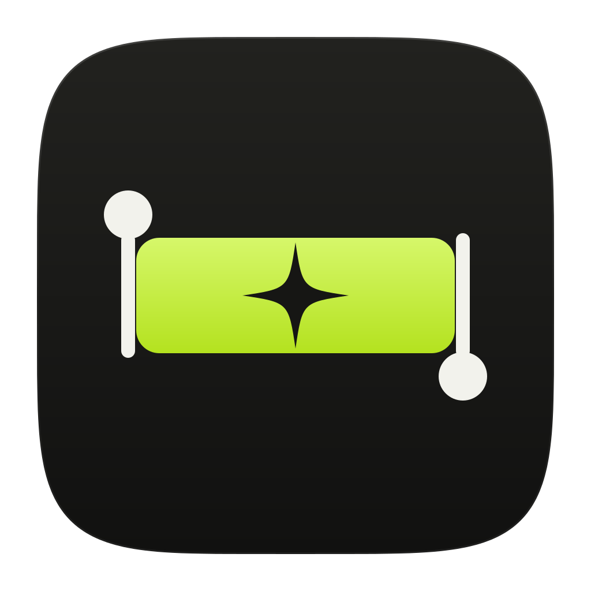
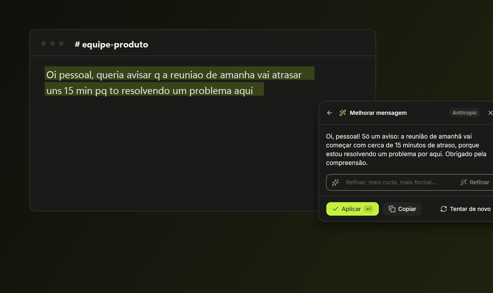
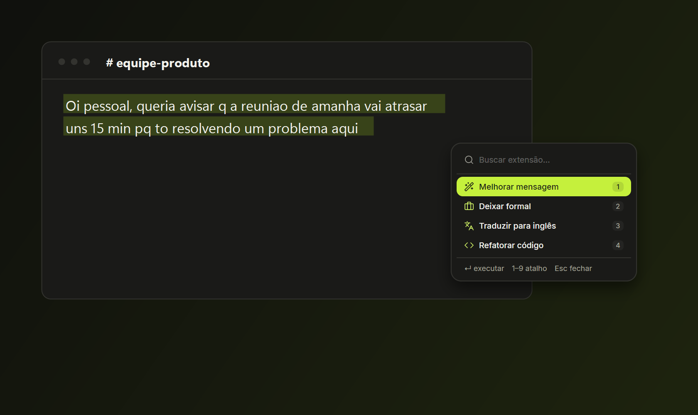
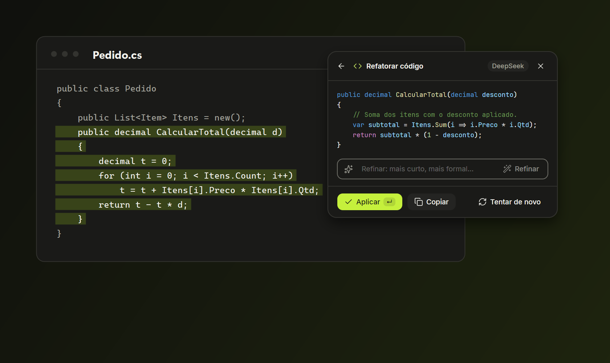
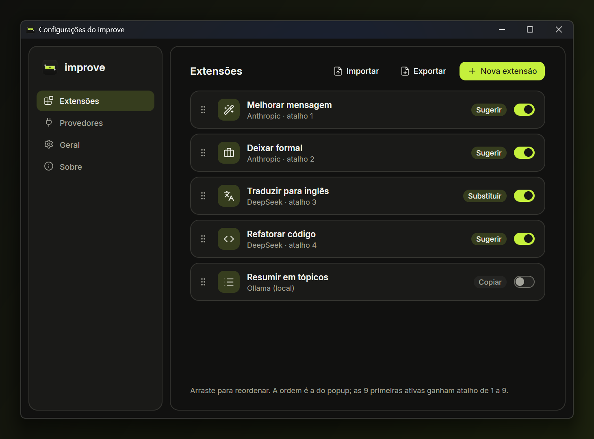
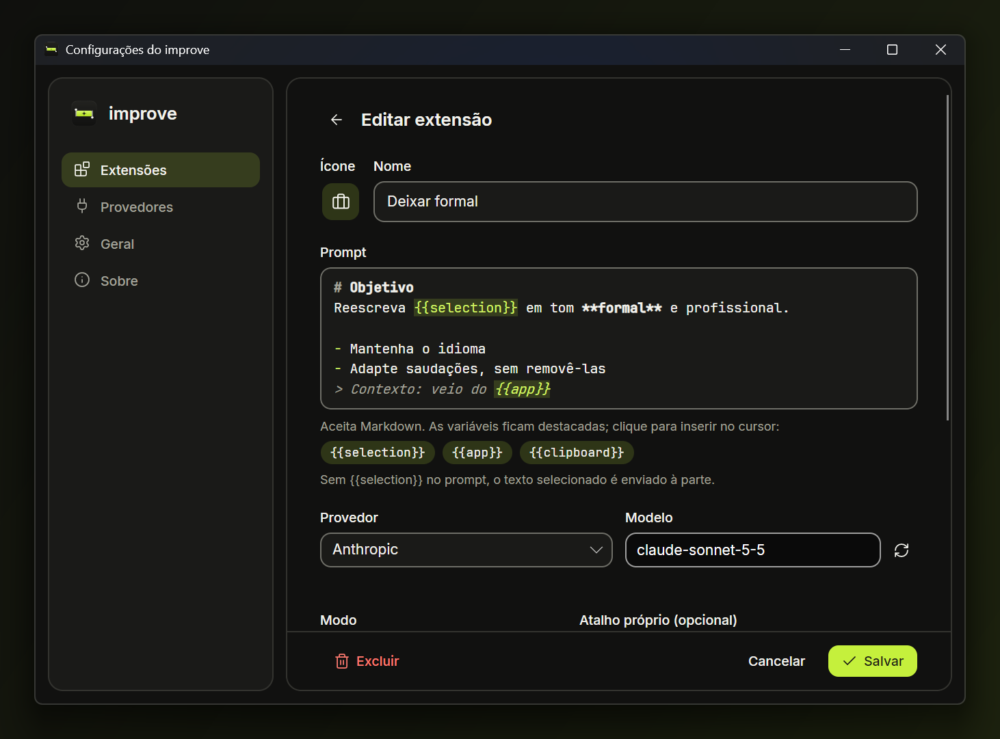
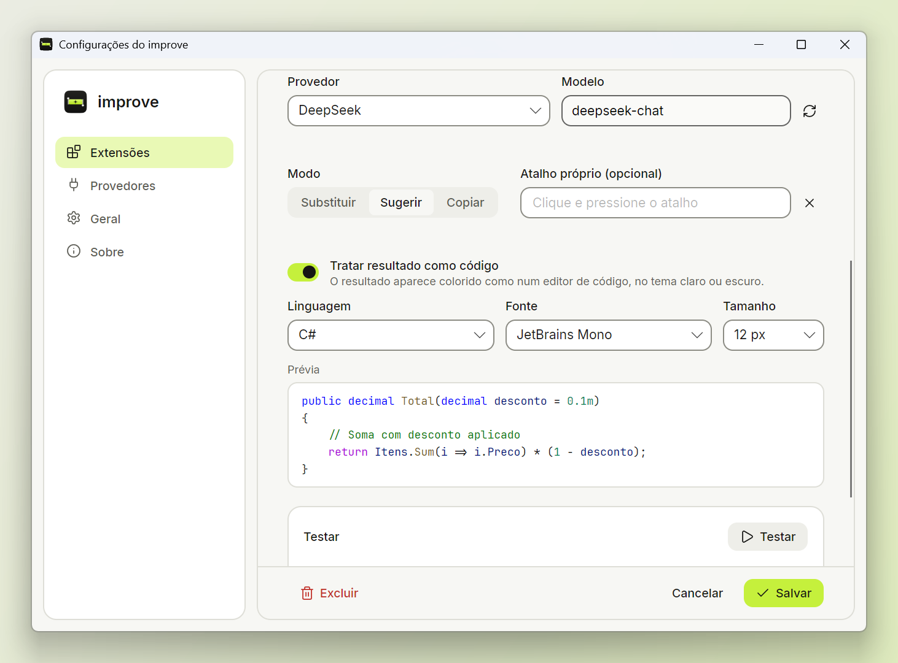
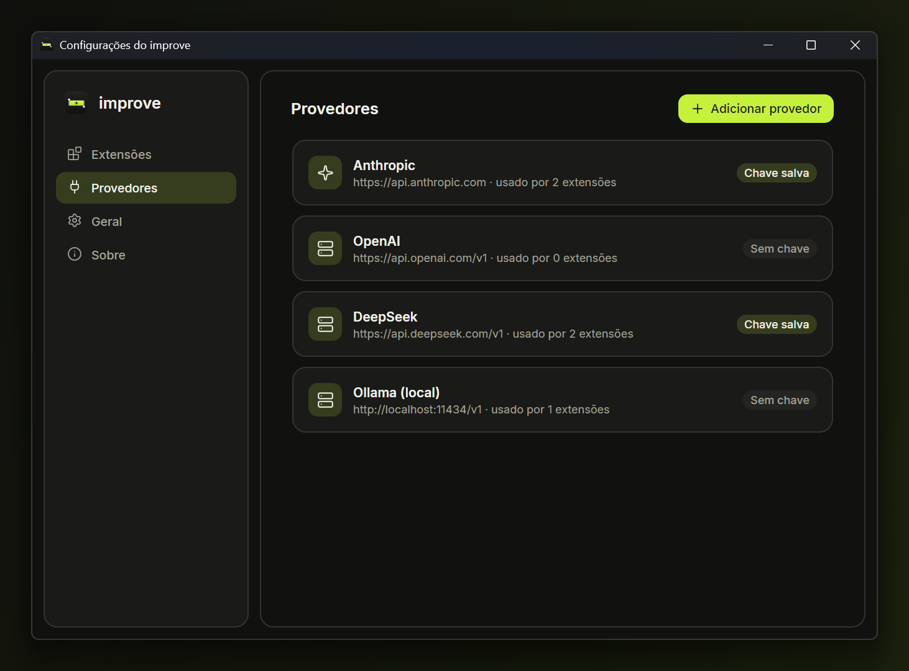

<p align="center">
  
</p>

<h1 align="center">improve</h1>

<p align="center"><b>Selecione. Escolha. Melhore.</b><br>
Aplique prompts de IA ao texto selecionado em qualquer aplicativo, com um atalho global.</p>

<p align="center">
  <a href="https://github.com/igoreusttaquio/Improve/releases/latest">Download</a> ·
  <a href="https://igoreusttaquio.github.io/Improve/">Site</a> ·
  <a href="#como-compilar">Compilar</a>
</p>

<p align="center">
  
</p>

## Como funciona

1. Selecione um texto em qualquer app: e-mail, chat, navegador, editor de código.
2. Aperte **Ctrl+Shift+Espaço** (no macOS, **Cmd+Shift+Espaço**).
3. Escolha uma extensão. O resultado substitui a seleção, aparece como sugestão ou vai para a área de transferência.

<p align="center">
  
  
</p>

## Recursos

- **Extensões:** cada uma é um prompt com ícone, provedor, modelo, modo (substituir, sugerir ou copiar) e atalho próprio opcional. Reordene arrastando; as 9 primeiras ganham os atalhos 1 a 9 no popup. Importe e exporte em JSON.
- **Editor de prompt** com Markdown e variáveis `{{selection}}`, `{{app}}` e `{{clipboard}}`.
- **Qualquer provedor:** Anthropic, OpenAI, DeepSeek, Ollama local ou qualquer API compatível com a da OpenAI. O modelo é escolhido da lista do provedor.
- **Resultado como código:** realce de sintaxe nos temas claro e escuro, com linguagem, fonte e tamanho configuráveis por extensão.
- **Refinar** o resultado antes de aplicar ("mais curto", "mais formal").
- **Privacidade:** chaves no cofre do sistema (DPAPI no Windows, Keychain no macOS, libsecret no Linux). Texto selecionado, respostas e chaves nunca vão para logs. Cada execução é um pedido novo, sem histórico guardado.
- **Tema claro e escuro**, interface em português, inglês e espanhol, início com o sistema.

<p align="center">
  
  
</p>
<p align="center">
  
  
</p>

## Download

Na [última release](https://github.com/igoreusttaquio/Improve/releases/latest):

| Sistema | Arquivo |
| --- | --- |
| Windows 10/11 (x64) | `improve-setup-x64.exe` |
| Linux (Debian/Ubuntu, x64) | `improve-linux-amd64.deb` |
| macOS Apple Silicon | `improve-macos-arm64.dmg` |
| macOS Intel | `improve-macos-x64.dmg` |

O Windows é a plataforma principal hoje. macOS e Linux estão em prévia.

## Como compilar

Requer o [.NET 10 SDK](https://dotnet.microsoft.com/download).

```sh
dotnet build
dotnet test
dotnet run --project src/Improve.App
```

| Pasta | Conteúdo |
| --- | --- |
| `src/Improve.Core` | modelos, prompts, provedores e armazenamento, sem Avalonia nem APIs de sistema |
| `src/Improve.Platform` | atalhos globais, área de transferência, foco, cofre de chaves |
| `src/Improve.App` | interface em Avalonia 12 |
| `design/` | design system (tokens, marca e referência visual) |
| `installer/` | scripts dos instaladores de Windows, Linux e macOS |
| `docs/` | landing page e decisões de implementação |

Os instaladores são gerados pelo GitHub Actions ao publicar uma tag `v*`.

## Feito com

.NET 10, [Avalonia](https://avaloniaui.net/), CommunityToolkit.Mvvm, [AvaloniaEdit](https://github.com/AvaloniaUI/AvaloniaEdit) + TextMateSharp, [SharpHook](https://github.com/TolikPylypchuk/SharpHook), ícones [Lucide](https://lucide.dev/), fontes Inter e JetBrains Mono. As licenças estão em [`licenses/`](licenses) e na tela Sobre do app.

## Licença

[MIT](LICENSE).
